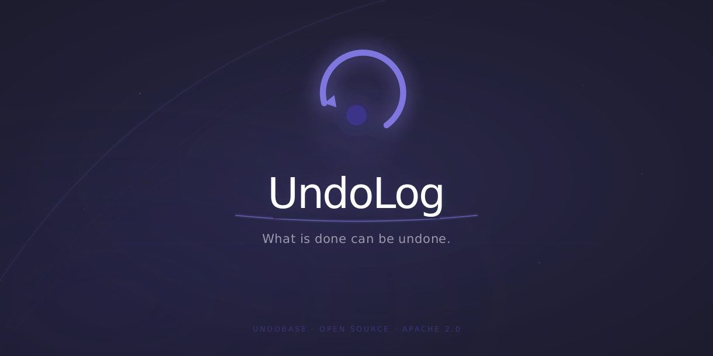

<div align="center">

  

  <p>
    <a href="https://undolog.undobase.com">Website</a>
    · <a href="https://github.com/UndoBase/UndoLog/issues">Issues</a>
  </p>
</div>

## UndoLog

AI agents send emails, create records, and transfer funds with no isolation, no rollback, and no authorization gate. A single hallucinated `DELETE` reaches production the same way a `SELECT` does. UndoLog fixes that.

Classify each tool call by reversibility. Log everything to a persistent effect journal. Pre-register compensations before execution. Gate irreversible operations behind human approval. Treat every tool call like a database transaction.

> No framework patches. No monkey-patching. The tool function never knows it is being managed.

Designed for LangGraph, CrewAI, OpenAI Agents SDK, or a custom agent loop. The unopinionated safety layer your agent infrastructure is missing.

### Why UndoLog

In April 2023, a Replit user asked an AI agent to "delete the test database." The agent complied. The production database was gone.

In February 2024, a Google D: drive wipe incident affected over 200,000 users when a single agent action cascaded without checkpoints.

These are not stories about bad models. They are stories about missing infrastructure.

### Architecture

UndoLog separates enforcement from orchestration across two processes backed by PostgreSQL. The Go proxy intercepts MCP and HTTP tool calls, enforcing rate limits, circuit breaking, and human approvals before execution. The Rust engine manages the persistent effect journal, validates BLAKE3 idempotency signatures, and drives compensation sagas on failure.

## Get started

For local development with zero infrastructure:

```sh
# Run the local development server (SQLite storage, zero external dependencies)
undolog dev
```

Install the SDK for your language:

```sh
# Python SDK
pip install undolog-sdk

# TypeScript SDK
npm install @undolog/sdk
```

Walk through the [quickstart guide](docs/getting-started/quickstart.md) or the [installation guide](docs/getting-started/installation.md) to set up production services. Then annotate your tools and UndoLog handles the rest.

## Documentation

The [full docs](docs/) follow the Diátaxis framework: tutorials, how-to guides, reference documentation, and explanation of the safety model. Start with the [quick start](docs/getting-started/quickstart.md) or dive straight into the [architecture decisions](docs/adr/).

## Project status

UndoLog is in active development with a 0.x release series. The gRPC engine contract, effect journal schema, and core SDK APIs are stable, while plugin interfaces, proxy backpressure levers, and framework wrappers continue to evolve. Breaking changes are documented in the [changelog](CHANGELOG.md), and production deployments should pin minor versions until 1.0.

## Contributing

Contributions are welcome. Read the [contributing guide](docs/contributing/CONTRIBUTING.md) to get started. Found a bug or have an idea? [Open an issue](https://github.com/UndoBase/UndoLog/issues).

## Security

If you discover a security vulnerability, email [security@undobase.com](mailto:security@undobase.com). All reports are promptly addressed.
